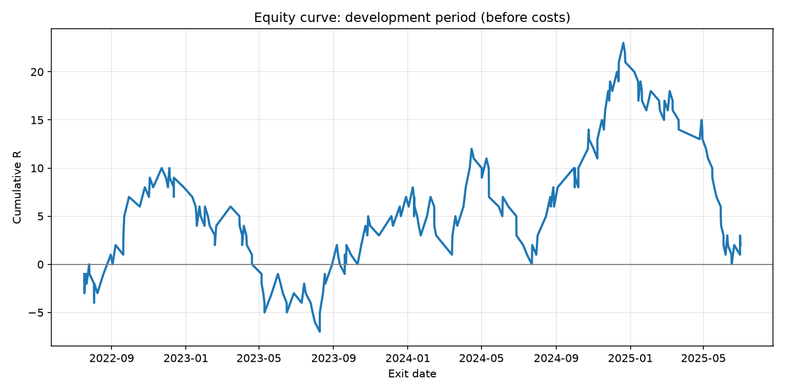

# XAUUSD Trend-Pullback Backtester

A Python framework for testing a rule-based trading strategy on 15-minute gold (XAUUSD) data, built from scratch as a self-directed project to learn Python, pandas and quantitative testing methods.

The goal is not to find a "money-making" strategy, but to test an idea **honestly**: with point-in-time data, no lookahead, a held-out test period, and results reported as they are.



*Equity curve over the development period (before costs). Large swings with no consistent upward trend: the strategy is roughly breakeven, with gains concentrated in particular periods and a 23R drawdown in the first half of 2025.*

---

## Strategy

| Part | Rule |
|---|---|
| **Trend filter** | Buys only when EMA(50) > EMA(200); sells only when EMA(50) < EMA(200) |
| **Setup** | Previous candle: RSI(7) **and** its 14-period moving average both below 30 (buy) / above 70 (sell) |
| **Trigger** | RSI(7) crosses back above 30 (buy) / below 70 (sell) |
| **Entry** | Open of the next candle |
| **Stop** | Lowest low (buy) / highest high (sell) of the 10 candles before entry |
| **Target** | 2 × risk (1:2 risk:reward) |

All settings live in `config.py`.

---

## How the backtest works

- **Data:** ~100,000 fifteen-minute candles (July 2022 – October 2026) exported from MetaTrader 5. Broker server time (New York + 7 hours) is converted to UTC, handling daylight saving.
- **Indicators** (EMA, RSI) are implemented from first principles and checked against TradingView.
- **Point-in-time:** indicators and signals only use data available at the close of each candle; trades enter on the *next* candle's open.
- **Event-driven loop:** the backtest steps through candles one at a time, one trade at a time, checking stop and target on every candle, including the entry candle.
- **Conservative assumptions:** if a candle touches both the stop and the target, it is counted as a loss. Trades where the entry has already gapped past the stop are skipped.
- **Development / test split:** rules are developed on July 2022 – June 2025. July 2025 – October 2026 is a locked test period, to be run once with final rules.

---

## Results (development period, before costs)

| Metric | Value |
|---|---|
| Trades | 223 |
| Win rate | 33.6% (breakeven at 1:2 is 33.3%) |
| Net result | +2 R |
| Expectancy | +0.009 R per trade |
| Max drawdown | −23 R |
| Longest winning streak | 4 |
| Longest losing streak | 14 |

**By direction**

| Direction | Trades | Net R |
|---|---|---|
| Buy | 101 | +16 |
| Sell | 122 | −14 |

**By year of exit**

| Year | Trades | Net R |
|---|---|---|
| 2022 (from July) | 34 | +8 |
| 2023 | 67 | −1 |
| 2024 | 79 | +14 |
| 2025 (to June) | 43 | −19 |

**Interpretation**

- The strategy is roughly **breakeven before trading costs**, so it shows no clear edge. Once the spread is included, it is likely to be slightly negative.
- **Buys were profitable while sells lost money**, during a period when gold more than doubled. The buy-side gains may reflect the overall uptrend rather than the setup itself.
- Results were **uneven over time**: two large drawdowns (about 17R in 2022–23 and 23R in 2025) each gave back most of the preceding gains.
- With ~220 trades, the win rate is only known to within roughly ±6 percentage points, so the result is consistent with no edge.

---

## Limitations

- No spread, commission or slippage modelled yet
- One instrument and one broker data feed
- Exits use exact stop/target prices (no gap fills)
- Moderate sample size
- Parameters are common conventions, not optimised values

---

## Project structure

```
config.py        # all settings (indicator lengths, levels, dates, paths)
data_loader.py   # loads the MT5 export, converts server time to UTC
indicators.py    # EMA, RSI, RSI moving average
signals.py       # trend filter, setup, trigger -> buy/sell signals
backtest.py      # event-driven trade simulation
metrics.py       # win rate, expectancy, drawdown, streaks, breakdowns
main.py         # runs the full pipeline, prints results, saves the equity curve
```

Pipeline: **load → indicators → signals → split by date → backtest → metrics → chart**

---

## How to run

1. Install Python 3.12+ and the requirements:
   ```
   python -m pip install -r requirements.txt
   ```
2. Export XAUUSD M15 history from MetaTrader 5 (tab-separated) and place it in the project folder. Update the path in `config.py`. Price data is not included in this repository.
3. Run:
   ```
   python main.py
   ```
   This prints the summary and breakdowns, and saves `equity_curve.png`.

---

## Next steps

- Model trading costs using the spread column
- Run the locked test period once with final rules
- Compare against random-entry and buy-and-hold baselines
- Sensitivity tests for stop lookback and RSI length
- Explore a machine-learning filter for trade selection, with time-based validation